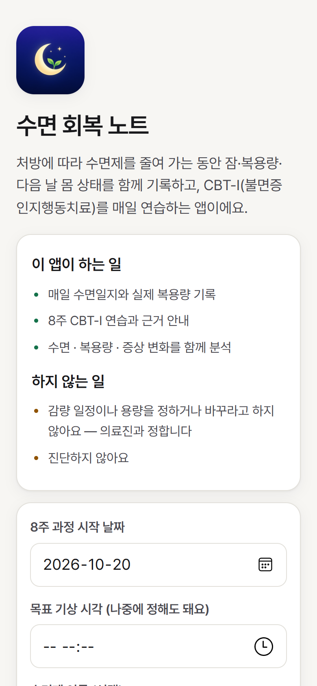
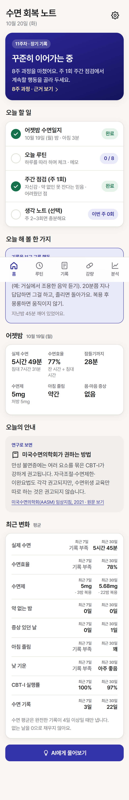
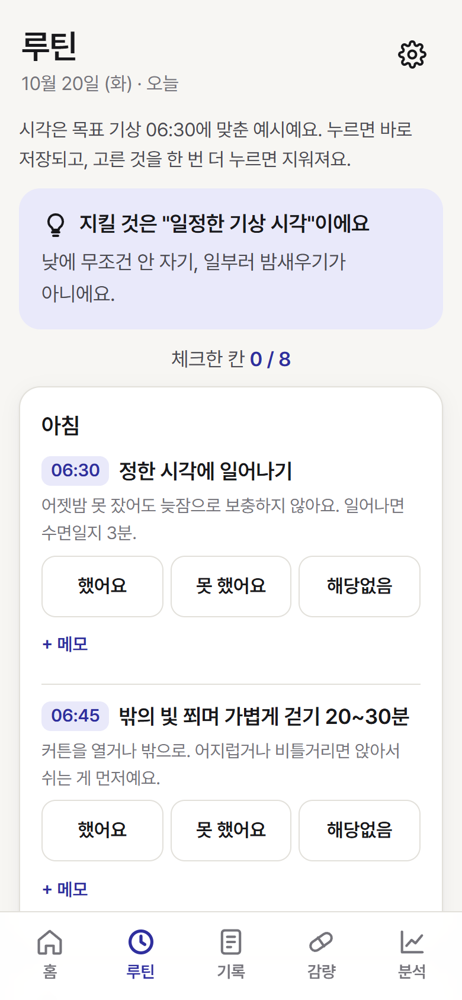
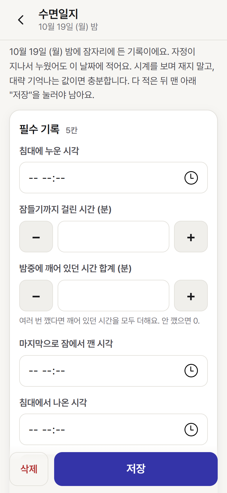
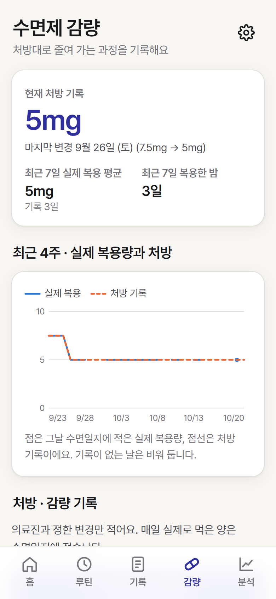
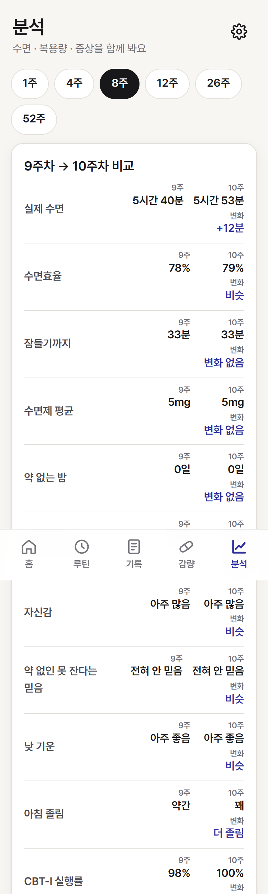
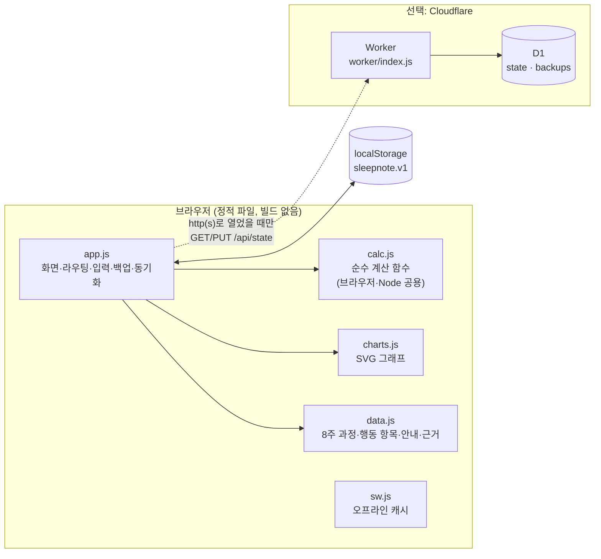
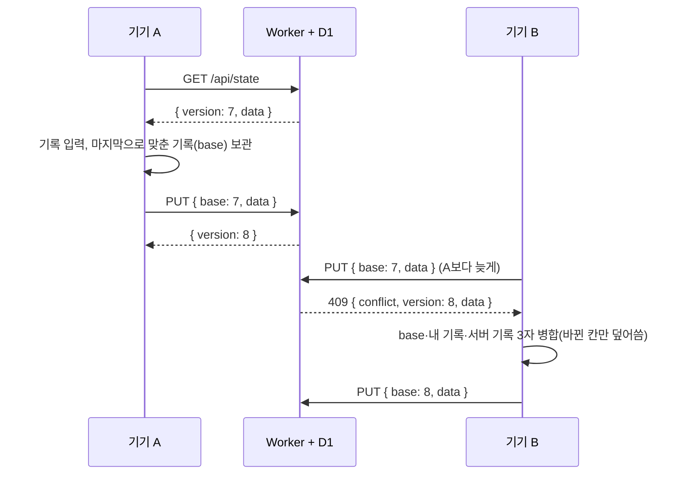

# 수면 회복 노트 (Sleep Recovery Note)

> 수면제를 **처방에 따라** 줄여 가는 동안 잠·복용량·다음 날 몸 상태를 매일 기록하고, **CBT-I(불면증 인지행동치료)** 8주 과정을 연습하며, 논문·지침 근거와 함께 변화를 분석해 보는 모바일 우선 웹앱(PWA)입니다.

> ⚠️ **의료 도구가 아닙니다.** 진단하지 않고, 감량 일정이나 용량을 정하거나 바꾸라고 지시하지 않습니다. 의료진과 정한 처방을 기록하고 실제 복용과 비교해 보여 주는 *기록·분석 도구*입니다. 수면제를 갑자기 끊거나 임의로 줄이지 마세요. 감량은 처방한 의료진과 상의해서 하세요.

*(English)* A mobile-first PWA for people tapering sleep medication under a doctor's supervision. It logs sleep diaries, actual doses and next-day symptoms, guides an 8-week CBT-I program, and shows trends side by side with the evidence it is based on (PubMed-linked trials and guidelines). It never prescribes or schedules a taper. Vanilla JS, no build step; optional Cloudflare Worker + D1 for multi-device sync.

<table>
<tr>
<td><br><sub>시작</sub></td>
<td><br><sub>홈</sub></td>
<td><br><sub>루틴</sub></td>
</tr>
<tr>
<td><br><sub>기록</sub></td>
<td><br><sub>감량</sub></td>
<td><br><sub>분석</sub></td>
</tr>
</table>

> 화면 속 기록은 시험용 **가짜 데모 데이터**입니다.

## 주요 기능

- **홈** — 지금이 8주 과정 몇 주차인지, 오늘 할 일, 어젯밤 수면 요약, 상황별 안내와 연구 근거 한 가지
- **루틴** — 아침·낮·저녁 행동(정한 시각 기상, 졸릴 때만 침대, 걱정 기록, 이완 등)을 *했는지*만 체크. 점수가 아니라 행동
- **기록** — 매일 아침 수면일지(누운 시각·잠들기까지·밤중 깸·기상·침대 나온 시각), 실제 복용량, 증상, 생각 노트
- **감량** — 의료진과 정한 **처방 변경 기록**과 실제 복용량 그래프. 앱이 용량을 정해 주지 않음
- **분석** — 최대 52주: 실제 수면시간·수면효율·잠들기까지·복용량·약 없는 밤·CBT-I 실행률·자신감 등을 주 단위로 비교
- **기타** — 8주 과정과 근거 카드, "AI에게 물어보기"(내 기록을 묶어 질문 글 생성), 백업/복원(JSON), 엑셀용 CSV 내보내기, 큰 글씨·다크 모드

### 설계 원칙

- **지시하지 않고 기록·비교만 합니다.** 감량 일정, 용량, 수면제한 같은 의료적 결정은 앱이 하지 않습니다.
- **점수 숫자 대신 말.** 졸림·기운·자신감 같은 척도는 "아주 처짐 ~ 아주 좋음"처럼 말로 보여 줍니다.
- **없는 기록을 0으로 채우지 않습니다.** 주간 평균은 완전한 수면 기록이 4일 이상일 때만 냅니다. "안 먹음(0mg)"과 "기록 안 함(빈칸)"은 다릅니다.
- **인과를 단정하지 않습니다.** 수면·복용·증상이 함께 변해도 "원인"이라고 말하지 않고 함께 보여 줍니다.
- **안전이 먼저.** 복용 후 몽롱함, 심한 졸림, 어지럼, 복용 후 기억 없는 행동 같은 신호는 운전·낙상 주의와 의료진 상담 안내로 연결합니다.

## 근거 (논문·지침)

앱의 "연구로 보면" 카드와 8주 과정의 설명은 아래 자료를 바탕으로 합니다. 수치는 PubMed·PMC·출판사 페이지의 **초록과 대조**해 확인했습니다. 연구마다 대상(약 종류, 연령)과 지표(약 중단률, 불면 관해율)가 다르니, 앱에서는 숫자 옆에 그 차이를 함께 적었습니다. 원문 링크는 `js/data.js`의 `FACTS`, `REFERENCES`에 있습니다.

- [Morin 2004, Am J Psychiatry](https://pubmed.ncbi.nlm.nih.gov/14754783/) — 장기 복용 고령자 76명: 감량+CBT-I 10주 뒤 85% 중단 (감량만 48%, CBT-I만 54%) — 벤조디아제핀
- [Baillargeon 2003, CMAJ](https://pubmed.ncbi.nlm.nih.gov/14609970/) — 65명, 1년 뒤 감량+CBT-I 70% vs 감량만 24% (혈액검사로 확인)
- [Morin 2009, JAMA](https://pubmed.ncbi.nlm.nih.gov/19454639/) — 졸피뎀, 160명: 6개월 불면 관해율 68% vs 42% (중단률이 아닌 *관해* 비율)
- [Fung 2024, JAMA Intern Med](https://pubmed.ncbi.nlm.nih.gov/39374004/) — 55세 이상 188명: 가림 감량+강화 CBT-I 6개월 73.4% vs 58.6%
- [Gardner 2024 (YAWNS NB), JAMA Psychiatry](https://doi.org/10.1001/jamapsychiatry.2024.2731) — 65세 이상 565명 자가 관리 개입: 6개월 26.2% vs 일반 진료 7.5%
- [Coteur 2023 (Big Bird), Sleep](https://pubmed.ncbi.nlm.nih.gov/36413221/) — 916명 진료+온라인 CBT-I 학습: 1년 중단률 18% vs 20% (차이 없음)
- [Morin 2005, Behav Res Ther](https://pubmed.ncbi.nlm.nih.gov/15531349/) — 중단 성공 47명 2년 추적: 42.6% 재복용 (CBT만 한 군 69% vs 감량을 한 군 31~33%)
- [Bélanger 2005, Health Psychol](https://pubmed.ncbi.nlm.nih.gov/15898864/) · [Belleville 2008, Health Psychol](https://pubmed.ncbi.nlm.nih.gov/18377143/) — 감량 중 자기효능감·불안과 성공의 관계
- [Lähteenmäki 2014, Br J Clin Pharmacol](https://pubmed.ncbi.nlm.nih.gov/24286360/) — 55세 이상 92명, 멜라토닌 병행 감량 (멜라토닌은 도움 안 됨, 6개월 뒤 중단 유지 감소)
- [Edinger 2021, AASM 지침](https://pmc.ncbi.nlm.nih.gov/articles/PMC7853203/) — 만성 불면증 다요소 CBT-I 강력 권고, 자극조절·이완 각각 권고
- [Zeraatkar 2025, BMJ](https://pubmed.ncbi.nlm.nih.gov/40527546/) · [Takaesu 2019, Sleep Med Rev](https://pubmed.ncbi.nlm.nih.gov/31648145/) · [Tannenbaum 2014, JAMA Intern Med](https://pubmed.ncbi.nlm.nih.gov/24733354/) — 중단 방법 체계적 문헌고찰(49개 시험; 환자 교육 등만 효과 가능성, 근거 확실성 낮음), CBT-I+감량 메타분석(3개월 이하 유리·12개월 비유의), 환자 교육 EMPOWER 시험
- [Pottie 2018, Can Fam Physician](https://pmc.ncbi.nlm.nih.gov/articles/PMC5951648/) · [Alliance for Sleep 2023](https://pmc.ncbi.nlm.nih.gov/articles/PMC10095217/) · [ASAM 등 공동 지침 2025](https://www.asam.org/quality-care/clinical-guidelines/benzodiazepine-tapering) · [AFP 2019 해설](https://www.aafp.org/pubs/afp/issues/2019/0101/p57.html) — 수면제(BZRA) 감량 지침들
- [FDA 2019 안전성 경고](https://www.fda.gov/safety/medical-product-safety-information/certain-prescription-insomnia-medicines-new-boxed-warning-due-risk-serious-injuries-caused) — 졸피뎀 등 복잡 수면 행동 boxed warning

> 초록에 없는 본문 수치는 확인하지 못해 앱에서도 다루지 않았습니다. 새 자료를 넣을 때는 초록과 대조한 뒤 `js/data.js`에 추가하세요.

## 아키텍처



- **기록은 기기 안에 먼저 저장**됩니다(`localStorage`). 서버 없이 `index.html`만 열어도 모든 기능이 동작합니다.
- **계산은 `calc.js` 한 곳에** 모았습니다(수면효율, 주간 요약, 처방 적용일 계산 등). DOM에 의존하지 않아 Node에서 단위 시험이 가능합니다.
- **데이터와 화면을 분리**했습니다. 8주 과정, 행동 항목, 상황별 안내 문구, 근거 목록은 `data.js`에 있어 화면 코드를 건드리지 않고 고칠 수 있습니다.
- 외부 라이브러리·CDN이 없습니다(그래프도 직접 SVG로 그림). 오프라인에서도 동작합니다.

### 여러 기기 동기화 (선택)

웹 주소(http/https)로 열면 Worker의 `/api/state`에 기록을 **한 벌**로 저장해 휴대폰과 PC가 같은 기록을 봅니다.



- **낙관적 동시성**: 서버는 `base`가 현재 버전과 같을 때만 저장하고, 다르면 `409`와 최신 기록을 돌려줍니다.
- **3자 병합**(`merge3`): 두 기기가 동시에 고쳐도 *이 기기에서 바뀐 칸만* 서버 기록 위에 덮어써 합칩니다(날짜별 기록은 칸 단위).
- 하루 한 번 바뀌기 전 기록을 **30일간 백업**합니다(D1 `backups`).

## 폴더 구조

```text
sleep-recovery-note/
├─ index.html              앱 껍데기 (하단 탭 5개)
├─ manifest.webmanifest    PWA 설정
├─ sw.js                   오프라인 캐시 (웹 주소로 열었을 때만)
├─ css/app.css             전체 스타일 (밝게/어둡게, 큰 글씨 대응)
├─ js/
│  ├─ app.js               화면·라우팅·입력 폼·백업·동기화·병합
│  ├─ calc.js              순수 계산 함수 (수면효율, 요약, 처방 적용일 …)
│  ├─ charts.js            SVG 선 그래프 (툴팁, 점선 처방선)
│  └─ data.js              8주 과정, CBT-I 행동, 상황별 안내, 근거(논문) 목록
├─ worker/index.js         Cloudflare Worker: GET/PUT /api/state + D1 백업
├─ wrangler.jsonc          Worker·D1 설정 (database_id는 직접 채움)
├─ icons/                  앱 아이콘
├─ test/
│  ├─ calc.test.js         계산 함수 단위 시험 (47개)
│  └─ e2e_*.py             Playwright 화면 시험 4종
└─ docs/screenshots/       README 화면 캡처(가짜 데모 데이터)
```

## 시작하기

### 1) 바로 써 보기 (서버 없음)

`index.html`을 브라우저로 열면 됩니다. 처음 화면에서 **8주 과정 시작 날짜**를 정하고, 원하면 **수면제 이름·현재 하루 처방 용량(mg)** 을 적으세요(나중에 설정에서 바꿀 수 있습니다). 기록은 이 브라우저에만 저장됩니다.

홈 화면에 설치(PWA)하거나 오프라인 캐시를 쓰려면 웹 서버로 열어야 합니다.

```bash
python -m http.server 8080      # 또는 npx serve .
# http://localhost:8080
```

### 2) 같은 기록을 여러 기기에서 (Cloudflare, 선택)

```bash
npx wrangler login
npx wrangler d1 create sleep-note     # 출력된 database_id 를 복사
```

`wrangler.jsonc`의 `database_id`에 붙여 넣고 배포합니다.

```bash
npx wrangler deploy
```

로컬에서 시험하려면 `npm run dev` (포트 8793). 테이블은 첫 요청 때 자동으로 만들어집니다(`CREATE TABLE IF NOT EXISTS`).

> 🔒 **동기화 서버에는 로그인이 없습니다.** 주소를 아는 사람은 누구나 같은 기록을 읽고 쓸 수 있습니다. 수면·복용·증상은 민감한 건강 정보이므로 주소를 공유하지 말고, 가능하면 [Cloudflare Access](https://developers.cloudflare.com/cloudflare-one/policies/access/) 같은 접근 제어 뒤에 두세요. 검색 노출을 막는 `noindex` 설정이 들어 있지만 접근 제한은 아닙니다.

### 환경 변수

환경 변수와 API 키는 **필요 없습니다.** 설정 값은 `wrangler.jsonc`의 `database_id` 하나뿐입니다.

## 데이터와 개인정보

- 기록은 브라우저 `localStorage`(키 `sleepnote.v1`)에 저장되고, 동기화를 켠 경우에만 내가 배포한 Worker/D1에 저장됩니다. 제3자 서버로 보내지 않습니다.
- **"AI에게 물어보기"** 는 기록을 묶어 질문 글을 *만들어 줄 뿐*, 앱이 직접 AI에 전송하지 않습니다. 복사해서 붙여 넣을 서비스는 직접 고르세요.
- 백업 파일(JSON)에는 건강 정보가 들어 있으니 공유하거나 공용 컴퓨터에 남기지 마세요.
- 약 이름·처방 용량·복용 시작 시기 같은 값은 코드에 들어 있지 않고 사용자가 입력합니다.

## 테스트

```bash
node test/calc.test.js        # 계산 함수 단위 시험 (47개, 외부 의존성 없음)
```

화면 시험은 Playwright(Python)를 씁니다.

```bash
pip install playwright && playwright install chromium
BROWSER_CHANNEL=chrome python test/e2e_입력시험.py     # chrome 대신 msedge 도 가능
python test/e2e_52주시험.py && python test/e2e_큰글씨시험.py
```

`e2e_공유기록시험.py`는 `npm run dev`(포트 8793)로 로컬 Worker를 띄운 뒤 두 기기처럼 동시에 쓰는 시험입니다. 실서버 주소로는 돌리지 마세요(시험 기록으로 덮어씁니다).

> 이 저장소를 정리하면서 단위 시험(47개)과 화면 시험 3종(입력·52주·큰글씨)을 다시 실행해 통과를 확인했습니다. 동기화 시험(`e2e_공유기록시험.py`)은 실행하지 못했습니다.

## 한계

- 감량 효과·안전성을 판단하지 않습니다. 연구 수치는 *참고 자료*이며 개인에게 그대로 적용되지 않습니다.
- 한국어 전용 화면이고, 날짜·"하루의 경계(목표 기상 2시간 전)"는 한국 시간(UTC+9) 기준입니다.
- 화면 시험은 사용자가 쓰는 흐름 위주이며, 접근성(스크린 리더) 검사는 하지 않았습니다.

## 라이선스

[MIT](LICENSE) — 단, 이 도구와 문서는 의료 조언이 아닙니다.
